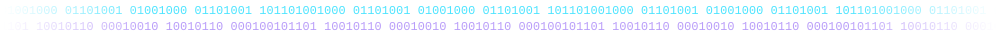
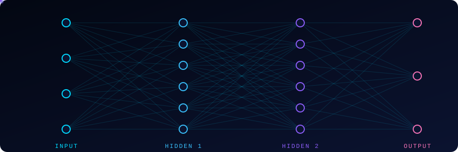

<!-- ANIMATED HEADER (binary rain + rotating title) -->
<p align="center">
  
</p>

<p align="center">
  
</p>

<p align="center">
  <a href="https://github.com/YOUR_GITHUB_USERNAME"></a>
  <a href="https://www.linkedin.com/in/YOUR_LINKEDIN_USERNAME/"></a>
  <a href="mailto:mehrasuhani.sm88@gmail.com"></a>
  
</p>



## 🖥️ `whoami`

```python
class Developer:
    name       = "Suhani Mehra"
    roles      = ["Full-Stack Developer", "AI/ML Engineer"]
    stack      = ["React", "Next.js", "Node.js", "Python", "PyTorch", "TensorFlow"]
    focus      = "Intelligent, production-ready web applications"
    currently  = "Integrating AI models into scalable full-stack systems"
    philosophy = "Combine creativity, code and intelligence to build what's next."

    def __repr__(self):
        return "01010011 01101111 01101100 01100101 01110110 01100101"  # Solve

me = Developer()
```

- 💻 **Full-stack engineering**: end-to-end apps, from responsive UIs to APIs, databases and system design.
- 🤖 **AI / ML**: machine learning fundamentals, computer vision, and AI-powered product experiences.
- 🚀 **Always shipping**: turning ideas into useful, polished digital experiences.


## 🛠️ Tech Stack

<table>
<tr>
<td width="50%" valign="top">

**🌐 Frontend**<br/>


**⚙️ Backend**<br/>


**🗄️ Databases**<br/>


</td>
<td width="50%" valign="top">

**🤖 AI & Machine Learning**<br/>


**🔧 Tools & Platforms**<br/>


</td>
</tr>
</table>


## 🧠 How I Think About Building AI Products

<p align="center">
  
</p>

<table>
  <tr>
    <td width="50%" valign="top">
      <h3>💻 Full-Stack Engineering</h3>
      <ul>
        <li>Modern web applications</li>
        <li>Frontend UI and UX</li>
        <li>REST API development</li>
        <li>Database design</li>
        <li>Authentication and security</li>
      </ul>
    </td>
    <td width="50%" valign="top">
      <h3>🤖 AI & Machine Learning</h3>
      <ul>
        <li>Machine learning fundamentals</li>
        <li>Data analysis and preprocessing</li>
        <li>Intelligent application development</li>
        <li>AI-powered web experiences</li>
        <li>Exploring generative AI</li>
      </ul>
    </td>
  </tr>
</table>


## 📊 GitHub Analytics

<p align="center">
  
  
</p>

<p align="center">
  
</p>

<p align="center">
  
</p>

### 🐍 Contribution Snake

<p align="center">
  <picture>
    <source media="(prefers-color-scheme: dark)" srcset="https://raw.githubusercontent.com/YOUR_GITHUB_USERNAME/YOUR_GITHUB_USERNAME/output/github-snake-dark.svg"/>
    
  </picture>
</p>


## 🌱 Currently Training On

```text
Epoch 1/∞  [████████████████████░░░░]  Full-stack architecture
Epoch 2/∞  [██████████████░░░░░░░░░░]  ML algorithms & AI tooling
Epoch 3/∞  [████████████░░░░░░░░░░░░]  Integrating AI into web apps
Epoch 4/∞  [██████████░░░░░░░░░░░░░░]  Scalable software design
loss: ↓ 0.0001   accuracy: ↑ always improving
```


## 💬 Let's Connect

I'm always happy to connect with fellow developers, AI enthusiasts, and people who love building innovative things.

<p align="center">
  <a href="https://github.com/YOUR_GITHUB_USERNAME"></a>
  <a href="https://www.linkedin.com/in/YOUR_LINKEDIN_USERNAME/"></a>
  <a href="mailto:mehrasuhani.sm88@gmail.com"></a>
</p>

<p align="center">
  
</p>

<p align="center">
  
</p>
